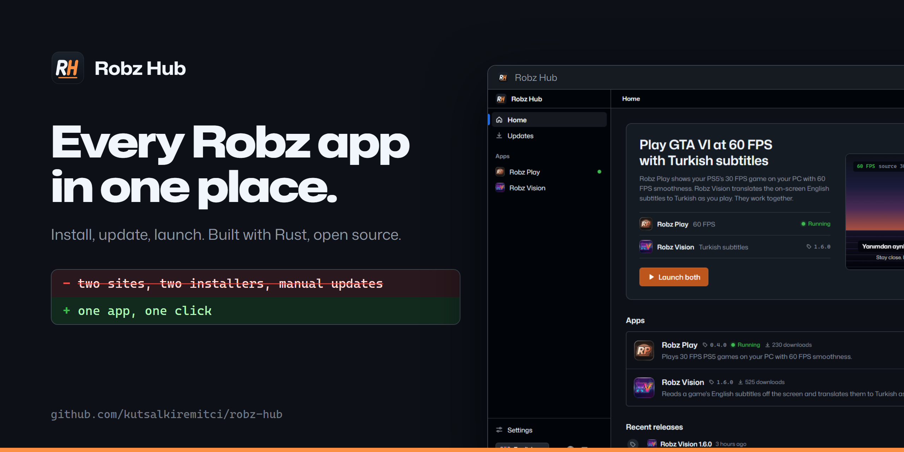
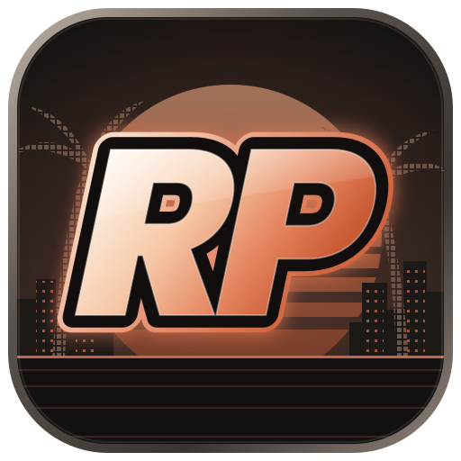
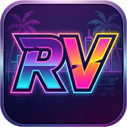
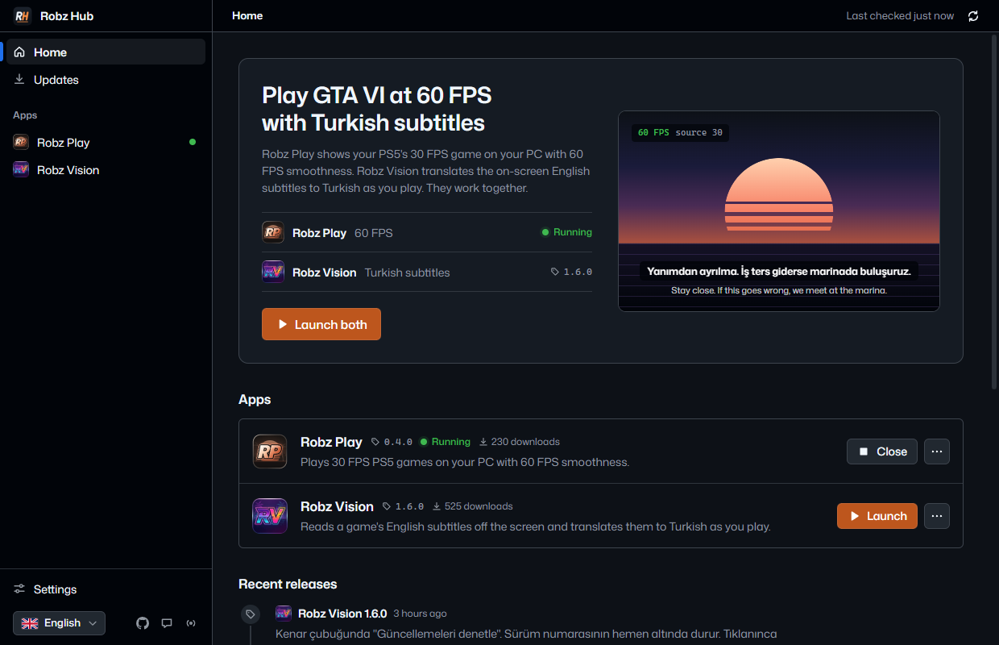
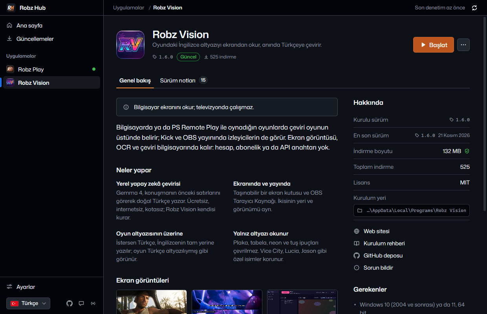
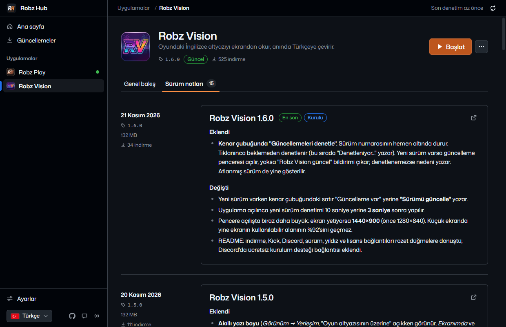
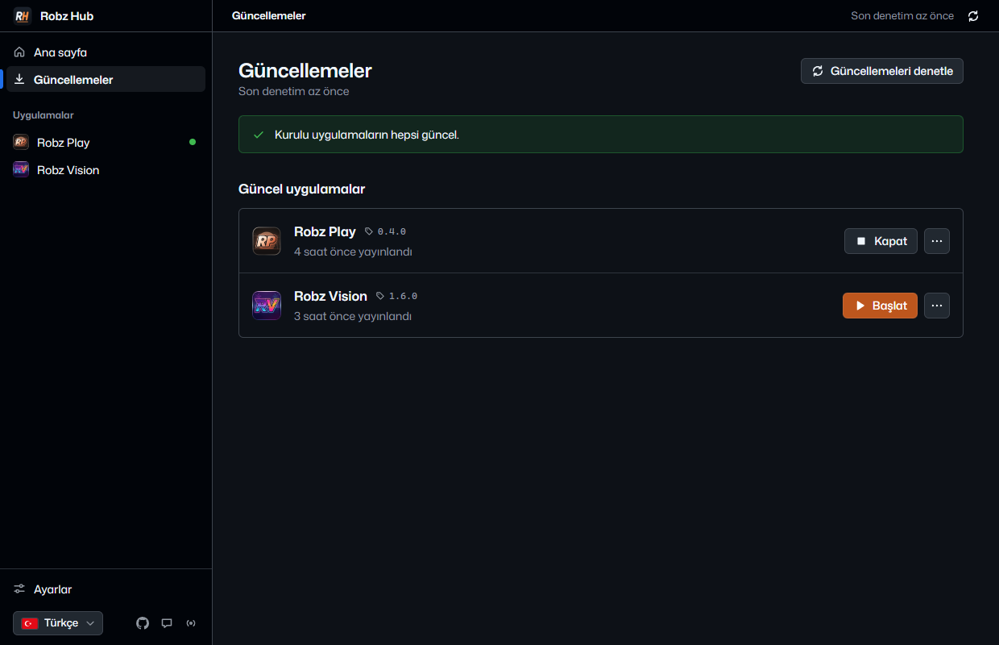

<p align="center">
  <a href="https://kutsalkiremitci.github.io/robz-hub/en/"></a>
</p>

<p align="center">
  <a href="https://github.com/kutsalkiremitci/robz-hub/releases/latest"></a>
  <a href="https://github.com/kutsalkiremitci/robz-hub/releases"></a>
  <a href="https://github.com/kutsalkiremitci/robz-hub/stargazers"></a>
  <a href="LICENSE"></a>
  <br>
  
  
  
  
</p>

<p align="center">
  <a href="https://github.com/kutsalkiremitci/robz-hub/releases/latest/download/RobzHub-Setup.exe"></a>
  <a href="https://github.com/kutsalkiremitci/robz-hub/stargazers"></a>
  <br>
  <a href="https://kutsalkiremitci.github.io/robz-hub/en/"></a>
  <a href="README.md"></a>
  <a href="https://discord.gg/UyyEn7SHm4"></a>
  <a href="https://kick.com/robzsogood"></a>
</p>

<h3 align="center">Install, update and launch the Robz open-source apps from one place.</h3>

<p align="center">
  <b>Robz Hub</b> is a small Windows app, written in <b>Rust</b>, that brings every Robz app into one window.<br>
  Play GTA VI at 60 FPS with <b>Robz Play</b> and read its subtitles in Turkish with <b>Robz Vision</b>:<br>
  one click instead of finding, downloading and updating each of them yourself.
</p>

```diff
- Open Robz Play's page, find the right installer, download, install
- Open Robz Vision's page, pick Setup or Portable, download, install
- New version out? Check both repositories one by one
+ Install Robz Hub once
+ Press "Install both": files download, get verified, install
+ A notification arrives with each new version; press "Update"
```

## Contents

- [What's inside](#whats-inside)
- [What it does](#what-it-does)
- [Get started in 3 steps](#get-started-in-3-steps)
- [User guide](#user-guide)
- [FAQ and troubleshooting](#faq-and-troubleshooting)
- [Security and privacy](#security-and-privacy)
- [Why Rust?](#why-rust)
- [Adding an app to Robz Hub](#adding-an-app-to-robz-hub)
- [Development](#development)
- [Support and contributing](#support-and-contributing)

## What's inside

| | App | What it does | Latest |
|:---:|---|---|---|
|  | **[Robz Play](https://github.com/kutsalkiremitci/robz-play)**<br><sub>60 FPS · AGPL-3.0</sub> | Plays 30 FPS PS5 games such as GTA VI on your PC **with 60 FPS smoothness**. It connects to your PS5 over your home network with 1080p Remote Play and your graphics card generates the in-between frames. No capture card needed. | <a href="https://github.com/kutsalkiremitci/robz-play/releases/latest"></a> |
|  | **[Robz Vision](https://github.com/kutsalkiremitci/robz-vision)**<br><sub>Turkish subtitles · MIT</sub> | **Reads a game's English subtitles off the screen and translates them to Turkish as you play**; the translation shows over the game and on Kick/OBS streams. Translation runs on your PC, offline and free. | <a href="https://github.com/kutsalkiremitci/robz-vision/releases/latest"></a> |

> [!TIP]
> **GTA VI bundle:** the "Play GTA VI at 60 FPS with Turkish subtitles" box on the Robz Hub home page manages both apps
> together. **Install both** downloads and installs them in turn; **Launch both** opens them together. Robz Play raises
> the picture to 60 FPS and Robz Vision translates the subtitles in that picture.

The list comes from [`catalog.json`](catalog.json) on GitHub. When a new Robz app is added to the catalog, it appears
for every user without updating Robz Hub.

## What it does

<table>
  <tr>
    <td width="33%" valign="top"><b>One-click install</b><br>
      Installers come from each app's own GitHub release, get verified and run silently. You see progress, speed and
      time left, and can cancel at any time.</td>
    <td width="33%" valign="top"><b>Stay up to date</b><br>
      When a new version is out, a counter appears in the sidebar and Windows shows a notification. Read what changed
      and press <b>Update</b>; your settings are kept.</td>
    <td width="33%" valign="top"><b>Launch and close</b><br>
      Open installed apps from here; running ones get a green dot. With the window closed, launch them from the tray
      icon.</td>
  </tr>
  <tr>
    <td valign="top"><b>Release notes built in</b><br>
      Every release of every app with its date. Ones newer than yours are marked <b>New</b>; when updating you also
      see the notes of every version in between.</td>
    <td valign="top"><b>Finds what you have</b><br>
      If you installed the apps yourself, Robz Hub finds them and their versions in the Windows records. No need to
      reinstall.</td>
    <td valign="top"><b>Updates itself</b><br>
      A new Robz Hub version shows at the top of the Updates page; one click downloads, installs and reopens it.</td>
  </tr>
  <tr>
    <td valign="top"><b>Small and fast</b><br>
      Built with Rust on Windows' own WebView2: the installer is about <b>2 MB</b> and it opens instantly.</td>
    <td valign="top"><b>Collects no data</b><br>
      No account, ads or usage statistics. It only talks to GitHub.</td>
    <td valign="top"><b>Turkish and English</b><br>
      Follows your Windows language; switch with the flag language picker in the sidebar.</td>
  </tr>
</table>

## Get started in 3 steps

1. **Download:** [RobzHub-Setup.exe](https://github.com/kutsalkiremitci/robz-hub/releases/latest/download/RobzHub-Setup.exe)
   (about 2 MB, always the latest version).
2. **Install:** run it. No admin rights needed; it installs for your user account only in a few seconds. If Windows
   shows **"Windows protected your PC"**, choose **More info** › **Run anyway** (the file isn't digitally signed yet;
   apps that Robz Hub installs don't show this warning).
3. **Install the apps:** in Robz Hub, press **Install both** on the home page. When it's done, **Launch both**.

## User guide

<p align="center">
  
</p>

### Home

- **Bundle box** (top): apps meant to be used together. The button follows the state: **Install both** when neither
  is installed, **Install the missing one** when one is missing (**Install and update** if the other also has an
  update), **Launch both** when all are installed, with **Update** next to it when there's a new version. The total
  download size is shown next to it, and each app's version or running state below.
- **Apps list:** each row shows the installed version, the total download count on GitHub, the `− old` `+ new` change when an update exists, and the
  buttons that make sense right now (**Install**, **Update**, **Launch**, **Close**). The **⋯** menu at the end has:
  open install folder, reinstall, website, GitHub repository, report an issue and **Uninstall**.
- **Recent releases:** new versions of every app in one feed; click one to open its notes.

### App page

Click an app in the sidebar. **Overview** shows what it does, what it needs, screenshots (click to enlarge) and an
**About** section: installed version, latest version and its date, download size (the shield means the file will be
verified), total downloads, license and **install location** (click to open the folder).

**Release notes** lists every release on a timeline like GitHub's; yours is marked **Installed** and newer ones
**New**, and each release shows its size and how many times it was downloaded. Long notes expand with **Show all**.

<table>
  <tr>
    <td width="50%"></td>
    <td width="50%"></td>
  </tr>
</table>

### While installing, updating and uninstalling

- Jobs queue up: two installers never run at once. You can **Cancel** a queued or downloading job.
- After download, the file's size and SHA-256 digest are checked against GitHub's; **File verified** appears under
  the progress bar. If they don't match, the file is deleted and nothing is installed.
- If the app is running, Robz Hub asks first, then closes it and installs.
- When a job finishes, a message shows the result in the bottom right (for example **Robz Vision updated to 1.6.0**)
  with a **Launch** button. If something goes wrong, the reason and **Try again** appear on that row.
- The Robz Hub taskbar icon shows download progress too.

### Updates page



Every app with a pending update is listed with the change from your version to the new one and the newest release
notes. If you skipped versions, **Notes for N versions in between** shows them all. With more than one update, use
**Update all**. A new Robz Hub version also appears at the top of this page.

**Check for updates** at the top right asks GitHub right away. Robz Hub also does this at startup, every six hours and
when you bring the window back after more than half an hour.

<br clear="right">

### Settings

| Setting | What it does |
|---|---|
| **Language** | Windows language, Türkçe or English. The flag language picker at the bottom of the sidebar is the same setting. |
| **Start with Windows** | Robz Hub starts in the tray when the PC starts and tells you about new versions. |
| **Keep in the tray when closed** | Closing the window keeps Robz Hub running in the tray next to the clock. |
| **Check for new versions automatically** | Asks GitHub at startup and every six hours. |
| **Notify about new versions** | Shows a Windows notification when an installed app gets a new version (once per version). |
| **Keep installer files** | When off, a downloaded installer is deleted after it has run. **Delete files** clears stored ones. |

### Tray icon

Click the Robz Hub icon next to the clock to open the window. Its right-click menu has **Open Robz Hub**, **Launch**
for each installed app, **Check for updates** and **Quit**.

## FAQ and troubleshooting

<details>
<summary><b>Does Robz Hub cost anything?</b></summary>

No. Robz Hub and the apps in it are free and open source; no account or payment needed.
</details>

<details>
<summary><b>I already installed the apps. Do I need to reinstall?</b></summary>

No. Robz Hub finds installed apps and their versions on its own, from the Windows "Installed apps" list and the apps'
default folders. If a new version exists, an **Update** button appears. If you update from inside the app itself,
Robz Hub notices that too.
</details>

<details>
<summary><b>Where do the apps get installed?</b></summary>

Each app installs with its own installer to its usual place: Robz Play to `%LOCALAPPDATA%\Programs\Robz Play`, Robz
Vision to `%LOCALAPPDATA%\Programs\Robz Vision`. **Install location** on the app page opens the folder. Robz Hub
itself installs to `%LOCALAPPDATA%\Robz Hub`.
</details>

<details>
<summary><b>If I uninstall Robz Hub, do the apps go too?</b></summary>

No. Robz Hub is only a manager; the apps it installed are independent and keep working. Uninstall Robz Hub from
**Windows Settings › Apps**.
</details>

<details>
<summary><b>"Windows protected your PC" appears</b></summary>

The installer isn't digitally signed yet, so SmartScreen shows this warning. Continue with **More info** › **Run
anyway**. You can verify the file against `SHA256SUMS.txt` on the release page:

```powershell
Get-FileHash .\RobzHub-Setup.exe
```
</details>

<details>
<summary><b>"GitHub request limit reached"</b></summary>

GitHub allows 60 requests an hour without an account; it can run out when many requests come from one network (for
example several PCs at home). Robz Hub tells you when the limit lifts and shows the last known versions until then;
installed apps aren't affected. Checks that find no change don't count against the limit.
</details>

<details>
<summary><b>A download stopped or "failed verification"</b></summary>

The partial or broken file is deleted and nothing is installed. **Try again** downloads it from the start. If it keeps
happening, check your connection and antivirus, then [report an issue](https://github.com/kutsalkiremitci/robz-hub/issues).
</details>

<details>
<summary><b>It says the app is running but I don't see a window</b></summary>

Some apps go to the tray when closed. Press **Close and try again**: Robz Hub first asks the app to close properly and
ends it if it doesn't.
</details>

<details>
<summary><b>Which Windows versions are supported?</b></summary>

64-bit Windows 10 and Windows 11. The interface uses Microsoft Edge WebView2, which Windows already includes; if it's
missing, the installer fetches it.
</details>

## Security and privacy

- **GitHub only.** Robz Hub connects to three places: `api.github.com` (release lists), `raw.githubusercontent.com`
  (catalog and images) and `github.com/<repo>/releases/download/…` (installers). The only thing it sends is a
  `User-Agent: RobzHub/<version>` header. No account, identity, ads or usage data.
- **Nothing runs unverified.** Installers are downloaded only from the cataloged repository's own release URL; if the
  size or SHA-256 digest differs from GitHub's, the file is deleted.
- **The catalog is checked strictly.** IDs, repository names, exe names, registry keys and folders from the remote
  catalog are accepted only in the expected format. Installer arguments never come from the catalog; they're fixed in
  code per installer type.
- **The interface is sandboxed.** Release notes are turned into safe HTML; the interface can't run outside scripts and
  reaches Windows only through a single command. External links open in your default browser.
- **No admin rights.** Robz Hub and the apps it installs go into your user account only.

## Why Rust?

The first draft of Robz Hub was built with Electron and its installer was **108 MB**; rewritten in Rust with
[Tauri](https://tauri.app) it's **1.9 MB**. Instead of bundling a browser, it uses Windows' own WebView2. Downloading,
SHA-256 verification, the Windows registry, process tracking and running installers are done directly in Rust through
the Windows API.

## Adding an app to Robz Hub

If you build a Robz app, add an entry to the `apps` list in [`catalog.json`](catalog.json) and bump the `revision` at
the top. Running Robz Hubs pick up the new catalog within half an hour (or when **Check for updates** is pressed).

<details>
<summary><b>Catalog fields</b></summary>

| Field | Purpose |
|---|---|
| `id` | Lowercase letters, digits and dashes (`robz-play`). |
| `name`, `repo` | Display name and GitHub repository (`owner/repo`). |
| `tagline`, `description`, `role` | `{ "tr": "…", "en": "…" }` or plain text. `role` shows next to the name in bundles. |
| `highlights`, `requirements`, `notice` | "What it does", "What you need" and the notice box on the app page. |
| `icon`, `screenshots` | `assets/…` (shipped with the app) or an `https://` URL. |
| `links` | `https://` links such as `website` and `guide`. |
| `releaseNotes` | Which part of the release notes to show: everything after the `from` heading (`"## Bu sürümde"`), and the notes' languages. |
| `windows.installer` | `inno` (Inno Setup) or `nsis`. |
| `windows.asset` | Regular expression for the installer's file name in a release (`^RobzPlay-Setup\\.exe$`). |
| `windows.uninstallKey` | Key under `HKCU\Software\Microsoft\Windows\CurrentVersion\Uninstall` (Inno: `{AppId}_is1`). |
| `windows.defaultDir`, `windows.exe` | Folder to check when there's no registry entry (`%LOCALAPPDATA%\Programs\…`) and the exe to run. |

`bundles` groups apps used together into one box on the home page. `announcements` shows a notice at the top of the
home page (a new app, a stream, a Discord invite).
</details>

**What the app's releases need:**

- The installer must be attached to the GitHub release and install per user, without admin rights.
- It must support silent install: Inno Setup `/VERYSILENT`, NSIS `/S`.
- For bilingual release notes, use `<!-- tr -->`, `<!-- en -->`, `<!-- end -->` markers; Robz Hub shows the part in
  the user's language.

## Development

**Requirements:** [Rust](https://rustup.rs) (MSVC), Node.js 22+, Visual Studio's C++ tools and the Windows SDK (Tauri's
[Windows prerequisites](https://tauri.app/start/prerequisites/)).

```powershell
npm install          # also copies interface libraries to ui/vendor
npm run dev          # run in development mode
npm test             # interface (node --test) and Rust (cargo test) tests
npm run build        # installer: src-tauri/target/release/bundle/nsis/
```

- With `ROBZHUB_DRY_RUN=1`, installers and uninstallers are not executed (downloading and verification are real): for
  trying the interface without touching the PC. `ROBZHUB_DATA_DIR` sets a separate folder for settings and downloads.
- `npm run screenshots` uses both to regenerate [`docs/screenshots`](docs/screenshots);
  `node scripts/render-banners.mjs` draws the README and preview images.
- The website builds to `site/dist` with `node site/build.mjs` and is published to GitHub Pages on every push to `main`.

```
catalog.json         app catalog (the copy on GitHub is live)
ui/                  interface: plain ES modules, Preact + htm, no bundler
  js/locales/        Turkish and English text
src-tauri/src/
  catalog.rs         catalog validation and loading
  github.rs          release lists, ETag cache
  download.rs        downloading and SHA-256 verification
  installs.rs        registry, exe version, processes, install/uninstall/launch
  hub.rs             state and job queue
  shell.rs           window, tray, notifications, taskbar
site/                website (generated from catalog.json)
```

**Releasing:** set the same version in `package.json`, `src-tauri/Cargo.toml` and `src-tauri/tauri.conf.json`, add
notes to [`CHANGELOG.md`](CHANGELOG.md) and push a `vX.Y.Z` tag. The workflow builds the installer and publishes it as
`RobzHub-Setup-X.Y.Z.exe` and `RobzHub-Setup.exe`; running Robz Hubs show the new version on the Updates page.

## Support and contributing

- **Stuck installing?** There's free support on [Discord](https://discord.gg/UyyEn7SHm4).
- **Found a bug or have an idea?** [Open an issue](https://github.com/kutsalkiremitci/robz-hub/issues).
- **New releases** are announced first on [Kick streams](https://kick.com/robzsogood).
- **Like it?** A ⭐ on the repository helps more people find the project.

Contributions are welcome: send a pull request for code, translations or a new app in the catalog.

## License

[MIT](LICENSE). Open-source parts used: [Tauri](https://tauri.app) (MIT / Apache-2.0), [Preact](https://preactjs.com)
and [htm](https://github.com/developit/htm) (MIT), [marked](https://marked.js.org) (MIT), the
[Mona Sans](https://github.com/github/mona-sans) typeface (SIL Open Font License 1.1).

<sub>Robz Hub and the apps in it are independent projects, not affiliated with Sony Interactive Entertainment, Rockstar
Games or Take-Two Interactive. GTA VI is a trademark of Rockstar Games.</sub>
