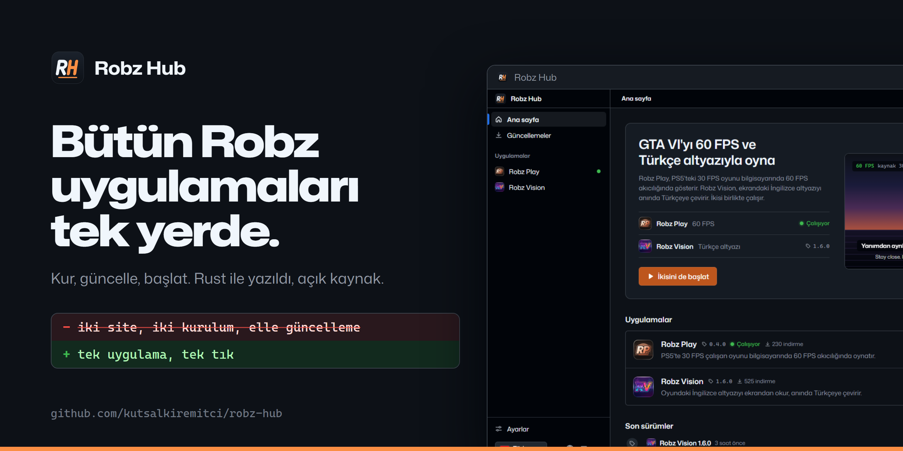
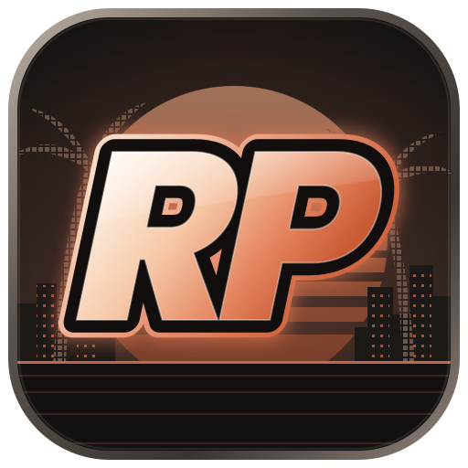
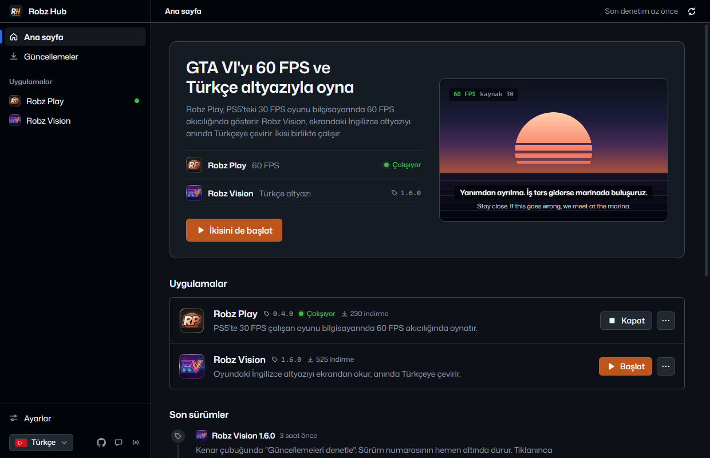
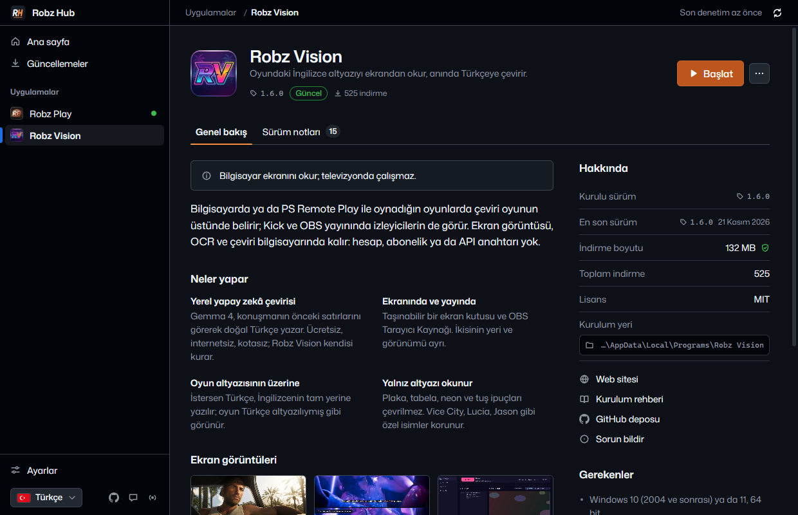
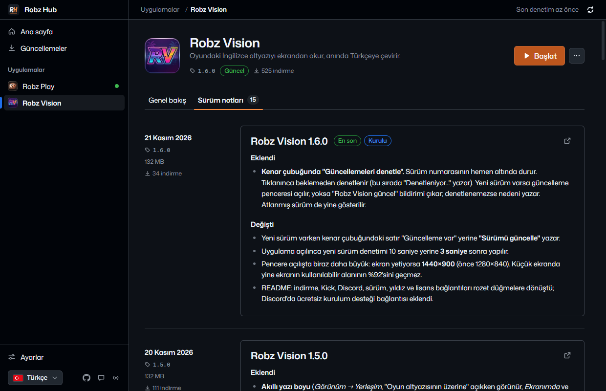
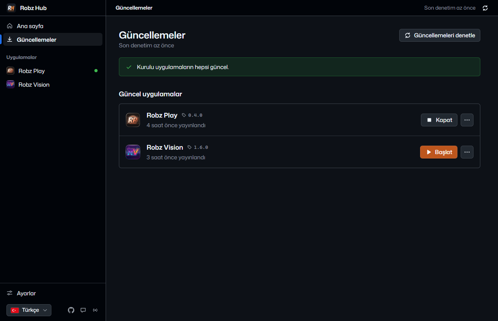

<p align="center">
  <a href="https://kutsalkiremitci.github.io/robz-hub/"></a>
</p>

<p align="center">
  <a href="https://github.com/kutsalkiremitci/robz-hub/releases/latest"></a>
  <a href="https://github.com/kutsalkiremitci/robz-hub/releases"></a>
  <a href="https://github.com/kutsalkiremitci/robz-hub/stargazers"></a>
  <a href="LICENSE"></a>
  <br>
  
  
  
  
</p>

<p align="center">
  <a href="https://github.com/kutsalkiremitci/robz-hub/releases/latest/download/RobzHub-Setup.exe"></a>
  <a href="https://github.com/kutsalkiremitci/robz-hub/stargazers"></a>
  <br>
  <a href="https://kutsalkiremitci.github.io/robz-hub/"></a>
  <a href="README.en.md"></a>
  <a href="https://discord.gg/UyyEn7SHm4"></a>
  <a href="https://kick.com/robzsogood"></a>
</p>

<h3 align="center">Robz'un açık kaynak uygulamalarını tek yerden kur, güncelle ve başlat.</h3>

<p align="center">
  <b>Robz Hub</b>, Robz uygulamalarını tek bir pencerede toplayan, <b>Rust</b> ile yazılmış küçük bir Windows uygulamasıdır.<br>
  GTA VI'yı <b>Robz Play</b> ile 60 FPS oyna, altyazısını <b>Robz Vision</b> ile Türkçe oku:<br>
  ikisini ayrı ayrı aramak, indirmek ve güncel tutmak yerine tek tıkla.
</p>

```diff
- Robz Play'in sayfasına gir, doğru kurulum dosyasını bul, indir, kur
- Robz Vision'ın sayfasına gir, Setup mı Portable mı diye seç, indir, kur
- Yeni sürüm çıktı mı? İki depoyu ayrı ayrı denetle
+ Robz Hub'ı bir kez kur
+ "İkisini de kur"a bas: dosyalar iner, doğrulanır, kurulur
+ Yeni sürüm çıkınca bildirim gelir, "Güncelle"ye bas
```

## İçindekiler

- [İçindeki uygulamalar](#i̇çindeki-uygulamalar)
- [Neler yapar](#neler-yapar)
- [3 adımda başla](#3-adımda-başla)
- [Kullanım kılavuzu](#kullanım-kılavuzu)
- [Sık sorulanlar ve sorun giderme](#sık-sorulanlar-ve-sorun-giderme)
- [Güvenlik ve gizlilik](#güvenlik-ve-gizlilik)
- [Neden Rust?](#neden-rust)
- [Robz Hub'a uygulama eklemek](#robz-huba-uygulama-eklemek)
- [Geliştirme](#geliştirme)
- [Destek ve katkı](#destek-ve-katkı)

## İçindeki uygulamalar

| | Uygulama | Ne yapar | Son sürüm |
|:---:|---|---|---|
|  | **[Robz Play](https://github.com/kutsalkiremitci/robz-play)**<br><sub>60 FPS · AGPL-3.0</sub> | PS5'te 30 FPS çalışan oyunu (GTA VI gibi) bilgisayarında **60 FPS akıcılığında** oynatır. PS5'e ev ağı üzerinden 1080p Remote Play ile bağlanır, aradaki kareleri ekran kartın üretir. Capture card gerekmez. | <a href="https://github.com/kutsalkiremitci/robz-play/releases/latest"></a> |
|  | **[Robz Vision](https://github.com/kutsalkiremitci/robz-vision)**<br><sub>Türkçe altyazı · MIT</sub> | Oyundaki **İngilizce altyazıyı ekrandan okur, anında Türkçeye çevirir**; çeviri oyunun üstünde ve Kick/OBS yayınında görünür. Çeviri bilgisayarında, internetsiz ve ücretsiz çalışır. | <a href="https://github.com/kutsalkiremitci/robz-vision/releases/latest"></a> |

> [!TIP]
> **GTA VI paketi:** Robz Hub'ın ana sayfasındaki "GTA VI'yı 60 FPS ve Türkçe altyazıyla oyna" kutusu iki uygulamayı
> birlikte yönetir. **İkisini de kur** sırayla indirip kurar, **İkisini de başlat** birlikte açar. Robz Play görüntüyü
> 60 FPS'e çıkarır, Robz Vision o görüntüdeki altyazıyı Türkçeye çevirir.

Liste GitHub'daki [`catalog.json`](catalog.json) dosyasından gelir. Yeni bir Robz uygulaması kataloğa eklendiğinde,
Robz Hub'ı güncellemeye gerek kalmadan bütün kullanıcıların listesinde belirir.

## Neler yapar

<table>
  <tr>
    <td width="33%" valign="top"><b>Tek tıkla kur</b><br>
      Kurulum dosyası uygulamanın kendi GitHub sürümünden iner, doğrulanır ve sessizce kurulur. İlerleme, hız ve kalan
      süre görünür; istediğin an iptal edersin.</td>
    <td width="33%" valign="top"><b>Güncel tut</b><br>
      Yeni sürüm çıkınca kenar çubuğunda sayaç belirir, Windows bildirimi gelir. Neyin değiştiğini okuyup
      <b>Güncelle</b>'ye basarsın; ayarların korunur.</td>
    <td width="33%" valign="top"><b>Başlat ve kapat</b><br>
      Kurulu uygulamalar buradan açılır; çalışanların yanında yeşil nokta yanar. Pencere kapalıyken tepsi simgesinden de
      başlatılır.</td>
  </tr>
  <tr>
    <td valign="top"><b>Sürüm notları içinde</b><br>
      Her uygulamanın bütün sürümleri tarihleriyle. Kurulu sürümünden sonra gelenler <b>Yeni</b> etiketiyle; güncellerken
      aradaki bütün sürümlerin notlarını da görürsün.</td>
    <td valign="top"><b>Kurulu olanı kendisi bulur</b><br>
      Uygulamaları daha önce elle kurduysan Robz Hub onları ve sürümlerini Windows'un kayıtlarından bulur. Yeniden
      kurman gerekmez.</td>
    <td valign="top"><b>Kendini de günceller</b><br>
      Robz Hub'ın yeni sürümü Güncellemeler sayfasının en üstünde çıkar; tek tıkla iner, kurulur, yeniden açılır.</td>
  </tr>
  <tr>
    <td valign="top"><b>Küçük ve hızlı</b><br>
      Rust ve Windows'un kendi WebView2'siyle yazıldı: kurulum dosyası yaklaşık <b>2 MB</b>, açılışı anlık.</td>
    <td valign="top"><b>Veri toplamaz</b><br>
      Hesap, reklam, kullanım istatistiği yok. Yalnız GitHub ile konuşur.</td>
    <td valign="top"><b>Türkçe ve İngilizce</b><br>
      Windows diline göre açılır; kenar çubuğundaki bayraklı dil seçiminden değişir.</td>
  </tr>
</table>

## 3 adımda başla

1. **İndir:** [RobzHub-Setup.exe](https://github.com/kutsalkiremitci/robz-hub/releases/latest/download/RobzHub-Setup.exe)
   (yaklaşık 2 MB, her zaman en son sürüm).
2. **Kur:** dosyayı çalıştır. Yönetici izni istemez, yalnız senin kullanıcı hesabına kurulur ve birkaç saniye sürer.
   Windows **"Windows kişisel bilgisayarınızı korudu"** uyarısı gösterirse **Ek bilgi** › **Yine de çalıştır**'a bas
   (dosya henüz dijital olarak imzalı değil; Robz Hub'ın kurduğu uygulamalarda bu uyarı çıkmaz).
3. **Uygulamaları kur:** Robz Hub açılınca ana sayfadaki **İkisini de kur**'a bas. Bittiğinde **İkisini de başlat**.

## Kullanım kılavuzu

<p align="center">
  
</p>

### Ana sayfa

- **Paket kutusu** (en üstte): birlikte kullanılan uygulamalar. Düğme duruma göre değişir: hiçbiri kurulu değilse
  **İkisini de kur**, biri eksikse **Eksik olanı kur** (diğerinde güncelleme de varsa **Kur ve güncelle**), hepsi
  kuruluysa **İkisini de başlat**; güncelleme varsa yanında **Güncelle** çıkar. Düğmenin yanında toplam indirme boyutu,
  altında her uygulamanın sürümü ya da çalıştığı görünür.
- **Uygulamalar listesi:** her satırda kurulu sürüm, GitHub'daki toplam indirme sayısı, güncelleme varsa `− eski` `+ yeni` sürüm geçişi ve o an anlamlı
  olan düğmeler (**Kur**, **Güncelle**, **Başlat**, **Kapat**). Satırın sonundaki **⋯** menüsünde: kurulum klasörünü
  aç, yeniden kur, web sitesi, GitHub deposu, sorun bildir ve **Kaldır**.
- **Son sürümler:** bütün uygulamaların yeni sürümleri tek akışta; birine tıklayınca o sürümün notları açılır.

### Uygulama sayfası

Kenar çubuğundan bir uygulamaya tıkla. **Genel bakış** sekmesinde ne yaptığı, neler gerektiği, ekran görüntüleri
(tıklayınca büyür) ve sağda **Hakkında** bölümü var: kurulu sürüm, en son sürüm ve tarihi, indirme boyutu (yanındaki
kalkan dosyanın doğrulanacağını gösterir), toplam indirme sayısı, lisans ve **kurulum yeri** (tıklayınca klasör açılır).

**Sürüm notları** sekmesinde bütün sürümler GitHub'daki gibi zaman çizelgesinde durur; kurulu olan **Kurulu**,
senden yeni olanlar **Yeni** etiketiyle işaretlidir; her sürümün yanında boyutu ve kaç kez indirildiği yazar. Uzun notlar
**Tümünü göster** ile açılır.

<table>
  <tr>
    <td width="50%"></td>
    <td width="50%"></td>
  </tr>
</table>

### Kurulum, güncelleme ve kaldırma sırasında

- İşler sıraya girer: iki kurulum aynı anda çalışmaz. Sırada bekleyen ya da inen bir işi **İptal** edebilirsin.
- İndirme bitince dosyanın boyutu ve SHA-256 özeti GitHub'ınkiyle karşılaştırılır; ilerlemenin altında
  **Dosya doğrulandı** yazar. Tutmazsa dosya silinir ve hiçbir şey kurulmaz.
- Uygulama açıksa Robz Hub önce sorar, sonra kapatır ve kurulumu yapar.
- İş bitince sağ altta sonucu gösteren bir bildirim çıkar (**Robz Vision 1.6.0 sürümüne güncellendi** gibi);
  üzerindeki **Başlat** ile hemen açabilirsin. Bir hata olursa ne olduğu ve **Yeniden dene** düğmesi o satırda görünür.
- Görev çubuğundaki Robz Hub simgesi de indirme ilerlemesini gösterir.

### Güncellemeler sayfası



Güncelleme bekleyen her uygulama, kurulu sürümünden yeni sürüme geçişiyle ve en yeni sürümün notlarıyla burada.
Arada atladığın sürümler varsa **Aradaki N sürümün notları** ile hepsini okursun. Birden fazla güncelleme varsa
**Tümünü güncelle**. Robz Hub'ın kendi yeni sürümü de bu sayfanın en üstünde görünür.

Sağ üstteki **Güncellemeleri denetle** GitHub'a hemen bakar. Robz Hub bunu kendisi de açılışta, altı saatte bir ve
pencereyi yarım saatten uzun süre sonra öne getirdiğinde yapar.

<br clear="right">

### Ayarlar

| Ayar | Ne yapar |
|---|---|
| **Dil** | Windows dili, Türkçe ya da English. Kenar çubuğunun altındaki bayraklı dil seçimi de aynı ayardır. |
| **Windows açılışında başlat** | Robz Hub bilgisayar açılınca tepside başlar ve yeni sürümleri bildirir. |
| **Kapatınca tepside kal** | Pencereyi kapatınca Robz Hub kapanmaz, saatin yanındaki tepside çalışmayı sürdürür. |
| **Yeni sürümleri kendiliğinden denetle** | Açılışta ve altı saatte bir GitHub'a bakar. |
| **Yeni sürümü bildir** | Kurulu bir uygulamanın yeni sürümü çıkınca Windows bildirimi gösterir (her sürüm için bir kez). |
| **Kurulum dosyalarını sakla** | Kapalıyken indirilen kurulum dosyası kurulumdan sonra silinir. **Dosyaları sil** ile saklananları temizlersin. |

### Tepsi simgesi

Saatin yanındaki Robz Hub simgesine tıklayınca pencere açılır. Sağ tık menüsünde: **Robz Hub'ı aç**, kurulu her
uygulama için **Başlat**, **Güncellemeleri denetle** ve **Çıkış**.

## Sık sorulanlar ve sorun giderme

<details>
<summary><b>Robz Hub ücretli mi?</b></summary>

Hayır. Robz Hub ve içindeki uygulamalar ücretsiz ve açık kaynaktır; hesap açman ya da bir şey ödemen gerekmez.
</details>

<details>
<summary><b>Uygulamaları zaten kurmuştum, yeniden kurmam gerekir mi?</b></summary>

Hayır. Robz Hub, Windows'un "Yüklü uygulamalar" kaydına ve uygulamaların varsayılan klasörlerine bakarak kurulu olanları
ve sürümlerini kendisi bulur. Yeni sürüm varsa **Güncelle** düğmesi görünür. Uygulamanın kendi içindeki "Güncelle"
düğmesiyle güncellersen Robz Hub bunu da görür.
</details>

<details>
<summary><b>Uygulamalar nereye kurulur?</b></summary>

Her uygulama kendi kurulum dosyasıyla, kendi varsayılan yerine kurulur: Robz Play
`%LOCALAPPDATA%\Programs\Robz Play`, Robz Vision `%LOCALAPPDATA%\Programs\Robz Vision`. Uygulama sayfasındaki
**Kurulum yeri** klasörü açar. Robz Hub'ın kendisi `%LOCALAPPDATA%\Robz Hub` klasörüne kurulur.
</details>

<details>
<summary><b>Robz Hub'ı kaldırırsam uygulamalar da gider mi?</b></summary>

Hayır. Robz Hub yalnız bir yöneticidir; kurduğu uygulamalar bağımsızdır ve kendi başlarına çalışmaya devam eder.
Robz Hub'ı **Windows Ayarlar › Uygulamalar**'dan kaldırabilirsin.
</details>

<details>
<summary><b>"Windows kişisel bilgisayarınızı korudu" uyarısı çıkıyor</b></summary>

Kurulum dosyası henüz dijital olarak imzalı olmadığı için SmartScreen bu uyarıyı gösterir. **Ek bilgi** ›
**Yine de çalıştır** ile devam edilir. Dosyanın doğruluğunu sürüm sayfasındaki `SHA256SUMS.txt` ile
denetleyebilirsin:

```powershell
Get-FileHash .\RobzHub-Setup.exe
```
</details>

<details>
<summary><b>"GitHub istek sınırına ulaşıldı" yazıyor</b></summary>

GitHub, hesapsız isteklere saatte 60 sınır koyar; aynı ağdan çok sayıda istek yapıldığında (ör. aynı evde birkaç
bilgisayar) dolabilir. Robz Hub sınırın ne zaman kalkacağını yazar ve o zamana kadar son bilinen sürümleri gösterir;
kurulu uygulamaların çalışmasına etkisi yoktur. Değişiklik olmayan denetimler sınıra sayılmaz.
</details>

<details>
<summary><b>İndirme yarıda kesildi ya da "dosya doğrulanamadı" yazdı</b></summary>

Yarım ya da bozuk dosya silinir ve hiçbir şey kurulmaz. **Yeniden dene** ile baştan indirilir. Sorun sürerse
internet bağlantını ve antivirüsünü denetle, sonra [sorun bildir](https://github.com/kutsalkiremitci/robz-hub/issues).
</details>

<details>
<summary><b>"Uygulama açık" diyor ama pencere görünmüyor</b></summary>

Bazı uygulamalar kapatınca tepsiye küçülür. **Kapat ve yeniden dene**'ye bas: Robz Hub uygulamayı önce düzgünce kapatmayı
dener, kapanmazsa sonlandırır.
</details>

<details>
<summary><b>Hangi Windows sürümlerinde çalışır?</b></summary>

64 bit Windows 10 ve Windows 11. Arayüz için Windows'ta zaten bulunan Microsoft Edge WebView2 kullanılır; bilgisayarında
yoksa kurulum onu kendisi indirir.
</details>

## Güvenlik ve gizlilik

- **Yalnız GitHub.** Robz Hub üç adrese bağlanır: `api.github.com` (sürüm listesi), `raw.githubusercontent.com`
  (katalog ve görseller) ve `github.com/<depo>/releases/download/…` (kurulum dosyaları). Gönderilen tek bilgi
  `User-Agent: RobzHub/<sürüm>` başlığıdır. Hesap, kimlik, reklam ya da kullanım verisi yoktur.
- **Doğrulanmadan çalıştırılmaz.** Kurulum dosyası yalnız katalogdaki deponun kendi sürüm adresinden indirilir; boyutu
  ve SHA-256 özeti GitHub'ın verdiğiyle aynı değilse silinir.
- **Katalog sıkı denetlenir.** Uzaktan gelen katalogda kimlik, depo adı, exe adı, kayıt anahtarı ve klasör yalnız
  beklenen biçimdeyse kabul edilir. Kurulum parametreleri katalogdan gelmez; kurulum türüne göre kodda sabittir.
- **Arayüz kapalı kutudur.** Sürüm notları güvenli HTML'e çevrilir; arayüz dışarıdan betik çalıştıramaz, Windows'a
  yalnız tek bir komut üzerinden erişir. Dış bağlantılar varsayılan tarayıcında açılır.
- **Yönetici izni yok.** Robz Hub da, kurduğu uygulamalar da yalnız senin kullanıcı hesabına kurulur.

## Neden Rust?

Robz Hub'ın ilk taslağı Electron ile yazıldı ve kurulum dosyası **108 MB** tuttu; Rust ve [Tauri](https://tauri.app)
ile yeniden yazılınca **1,9 MB**'a indi. Arayüz için ayrı bir tarayıcı paketlemek yerine Windows'un kendi WebView2'si
kullanılır. İndirme, SHA-256 doğrulama, Windows kayıt defteri, süreç takibi ve kurulum programlarını çalıştırma işleri
doğrudan Rust ile, Windows API'si üzerinden yapılır.

## Robz Hub'a uygulama eklemek

Bir Robz uygulaması geliştiriyorsan Robz Hub'a eklemek için [`catalog.json`](catalog.json) içindeki `apps` listesine
bir kayıt ekle ve en üstteki `revision` değerini bir artır. Çalışan Robz Hub'lar güncel kataloğu en geç yarım saat
içinde (ya da **Güncellemeleri denetle**'ye basınca) alır.

<details>
<summary><b>Katalog alanları</b></summary>

| Alan | Ne için |
|---|---|
| `id` | Küçük harf, rakam ve tire (`robz-play`). |
| `name`, `repo` | Görünen ad ve GitHub deposu (`sahip/depo`). |
| `tagline`, `description`, `role` | `{ "tr": "…", "en": "…" }` ya da düz metin. `role` paket kutusunda adın yanında görünür. |
| `highlights`, `requirements`, `notice` | Uygulama sayfasındaki "Neler yapar", "Gerekenler" ve uyarı kutusu. |
| `icon`, `screenshots` | `assets/…` (uygulamanın içindeki dosya) ya da `https://` adresi. |
| `links` | `website`, `guide` gibi `https://` bağlantıları. |
| `releaseNotes` | Sürüm notunda gösterilecek bölüm: `from` başlığından sonrası (`"## Bu sürümde"`) ve notun dilleri. |
| `windows.installer` | `inno` (Inno Setup) ya da `nsis`. |
| `windows.asset` | Sürümdeki kurulum dosyasının adı için düzenli ifade (`^RobzPlay-Setup\\.exe$`). |
| `windows.uninstallKey` | `HKCU\Software\Microsoft\Windows\CurrentVersion\Uninstall` altındaki anahtar (Inno: `{AppId}_is1`). |
| `windows.defaultDir`, `windows.exe` | Kayıt yoksa bakılacak klasör (`%LOCALAPPDATA%\Programs\…`) ve çalıştırılacak exe. |

`bundles` birlikte kullanılan uygulamaları ana sayfada tek kutuda toplar. `announcements` ana sayfanın üstünde duyuru
gösterir (yeni uygulama, yayın, Discord daveti gibi).
</details>

**Uygulamanın sürümlerinde gerekenler:**

- Kurulum dosyası GitHub sürümüne yüklenmeli ve yönetici izni istemeden, kullanıcıya kurulmalı.
- Sessiz kurulumu desteklemeli: Inno Setup `/VERYSILENT`, NSIS `/S`.
- Sürüm notunda iki dil varsa `<!-- tr -->`, `<!-- en -->`, `<!-- end -->` işaretleri kullan; Robz Hub kullanıcının
  dilindeki bölümü gösterir.

## Geliştirme

**Gerekenler:** [Rust](https://rustup.rs) (MSVC), Node.js 22+, Visual Studio'nun C++ araçları ve Windows SDK
(Tauri'nin [Windows ön koşulları](https://tauri.app/start/prerequisites/)).

```powershell
npm install          # arayüz kütüphanelerini de ui/vendor'a kopyalar
npm run dev          # geliştirme kipinde aç
npm test             # arayüz (node --test) ve Rust (cargo test) testleri
npm run build        # kurulum dosyası: src-tauri/target/release/bundle/nsis/
```

- `ROBZHUB_DRY_RUN=1` ile açılırsa kurulum ve kaldırma programları çalıştırılmaz (indirme ve doğrulama gerçektir):
  arayüzü bilgisayara dokunmadan denemek için. `ROBZHUB_DATA_DIR` ayarlar ve indirmeler için ayrı bir klasör verir.
- `npm run screenshots` bu ikisiyle uygulamayı açıp [`docs/screenshots`](docs/screenshots) görüntülerini yeniden üretir;
  `node scripts/render-banners.mjs` README ve önizleme görsellerini çizer.
- Web sitesi `node site/build.mjs` ile `site/dist`'e üretilir; `main`'e gönderilince GitHub Pages'e kendiliğinden yayınlanır.

```
catalog.json         uygulama kataloğu (GitHub'daki kopyası canlıdır)
ui/                  arayüz: düz ES modülleri, Preact + htm, paketleyici yok
  js/locales/        Türkçe ve İngilizce metinler
src-tauri/src/
  catalog.rs         katalog doğrulama ve yükleme
  github.rs          sürüm listesi, ETag önbelleği
  download.rs        indirme ve SHA-256 doğrulama
  installs.rs        kayıt defteri, exe sürümü, süreçler, kurulum/kaldırma/başlatma
  hub.rs             durum ve iş kuyruğu
  shell.rs           pencere, tepsi, bildirim, görev çubuğu
site/                web sitesi (catalog.json'dan üretilir)
```

**Sürüm yayınlamak:** sürüm numarasını `package.json`, `src-tauri/Cargo.toml` ve `src-tauri/tauri.conf.json`'da aynı
yap, [`CHANGELOG.md`](CHANGELOG.md)'ye notları yaz ve `vX.Y.Z` etiketini gönder. İş akışı kurulum dosyasını derler ve
`RobzHub-Setup-X.Y.Z.exe` ile `RobzHub-Setup.exe` adlarıyla yayınlar; çalışan Robz Hub'lar yeni sürümü Güncellemeler
sayfasında gösterir.

## Destek ve katkı

- **Kurulumda takıldın mı?** [Discord](https://discord.gg/UyyEn7SHm4) sunucusunda ücretsiz destek var.
- **Hata mı buldun, bir fikrin mi var?** [Sorun bildir](https://github.com/kutsalkiremitci/robz-hub/issues).
- **Yeni sürümler** önce [Kick'teki yayınlarda](https://kick.com/robzsogood) duyurulur.
- **Beğendiysen** depoya ⭐ vermen projeyi daha çok kişinin bulmasını sağlar.

Katkılar açık: kod, çeviri ya da kataloğa yeni bir uygulama için pull request gönderebilirsin.

## Lisans

[MIT](LICENSE). Kullanılan açık kaynak parçalar: [Tauri](https://tauri.app) (MIT / Apache-2.0),
[Preact](https://preactjs.com) ve [htm](https://github.com/developit/htm) (MIT), [marked](https://marked.js.org) (MIT),
[Mona Sans](https://github.com/github/mona-sans) yazı tipi (SIL Open Font License 1.1).

<sub>Robz Hub ve içindeki uygulamalar bağımsız projelerdir; Sony Interactive Entertainment, Rockstar Games ya da
Take-Two Interactive ile bağlantılı değildir. GTA VI, Rockstar Games'in ticari markasıdır.</sub>
